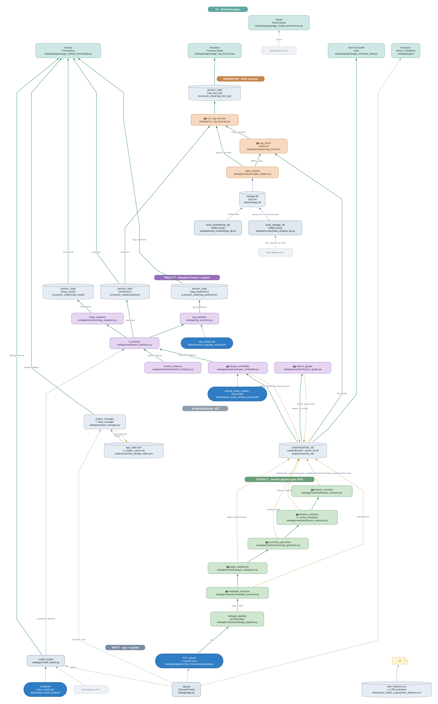

# codebase-diagrammer

**This whole codebase is claude-opus-5, then later opus5.5 generated. I find it useful. Helps you view your codebase using graphviz auto-layout. PR diffs, per-commit, are also a feature but require some token burn to get every change summarized, you can ask your agent to do that. Even after a few months I'm finding this useful to read the code agents write, instead of using the filesystem directly or git diffs to read the code changes.**
**The rest is just Claude Opus5.5 talking about the repo.**
A Claude Code skill that turns a repository into an editable draw.io diagram:
Claude reads the code and writes a graph JSON, Graphviz lays it out, and the
bundled scripts bake the positions and routed edges into a `.drawio` plus an
SVG and PNG. No draw.io application, no cloud service, no network access.

Nodes carry the file they stand for, so every box links to its source on GitHub
and every hover shows what that file actually does.



## Install

As a plugin:

```
/plugin marketplace add morganrivers/codebase-diagrammer
/plugin install codebase-diagrammer@codebase-diagrammer
```

Or drop the skill in by hand:

```
git clone https://github.com/morganrivers/codebase-diagrammer
cp -r codebase-diagrammer/skills/codebase-diagram ~/.claude/skills/
```

Then, in any repo:

```
/codebase-diagram
```

or just ask Claude to diagram how the repo fits together.

## Requirements

| requirement | needed for |
| --- | --- |
| Graphviz `dot` | layout |
| `defusedxml` | reading `.drawio` |
| `cairosvg`, or `rsvg-convert` / `inkscape` / `convert` | PNG only; SVG works without one |
| `lizard` | delta viewer, code metrics tab |
| `gh` CLI, logged in | delta viewer, PR titles and descriptions |
| `claude` CLI (Claude Code login) | delta viewer, change notes and summaries; `--no-notes` skips them |

```
python3 skills/codebase-diagram/scripts/check_deps.py
```

Diagrams can be viewed at `draw.io` using the upload tool, or from a downloaded drawio application on your computer offline.

## Using the scripts without Claude

The pipeline is a normal command-line tool. Write a graph JSON by hand
(`skills/codebase-diagram/reference/graph-schema.md` documents every field,
`skills/codebase-diagram/examples/` holds a working one) and run:

```
python3 skills/codebase-diagram/scripts/build_diagram.py graph.json --render
```

`drawio_to_png.py` also stands alone: it renders any `.drawio` this generator
produced, in either plain or draw.io-compressed form, to SVG and PNG locally.

```
python3 skills/codebase-diagram/scripts/drawio_to_png.py diagram.drawio
```

## Layout

The graph JSON declares ordered **bands**, the stages one unit of work passes
through. The builder enforces them with an invisible node between each pair,
weighted so it fixes vertical order without dragging every band into a column.
Edges that run backwards against the band order, and external services feeding
several bands at once, are drawn but not allowed to set rank, so one return
arrow cannot invert the page.

A node that many boxes use (a secrets loader, an API client) is drawn once and
marked ✳. Each user gets a small chip beside it instead of a long arrow back to
the shared node. `SKILL.md` describes the convention.

## Delta viewer: commits and PRs on the diagram

`delta_viewer.py` writes one self-contained HTML page that shows what recent
commits and pull requests changed, drawn on the built diagrams.

```
git fetch
python3 skills/codebase-diagram/scripts/delta_viewer.py docs/diagram/<name>.json \
    --ref origin/main -n 5 [--pr N ...] [--branch origin/<branch> ...] [--draft-prs] [--no-notes]
```

- The left list shows the last `-n` commits of `--ref`, plus any PRs and
  branches you name.
- A header toggle switches to one card per PR, with its commits folded in.
- On the diagram, boxes whose files changed are outlined green (added), amber
  (modified) or red (deleted), with line counts. The other boxes fade.
- The right panel shows the message, the PR description, and each file's diff,
  grouped by box. Files that no box covers are listed too.
- A metrics tab shows complexity, file count and lines of code per entry.

Unless you pass `--no-notes`, `change_notes.py` asks `claude -p` for a note per
changed file and a short summary per card. This uses your Claude Code login and
costs tokens. Results are cached in `delta_notes.json` and
`delta_summaries.json` next to the page, so a rebuild only asks about new
commits.

## Other scripts

- `check_edges.py docs/diagram/<name>.json [--ref origin/main]` compares the
  arrows with the repo's import graph. It lists imports that have no arrow, and
  arrows between code boxes that have no import.
- `status_page.py <name>_status.json` writes an HTML page that shows where a
  piece of work stands: workstreams, item states, tables and links. The JSON
  format is in the script's docstring.

## License

Public domain. See [LICENSE](LICENSE).
